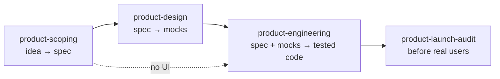

# product-skills

Claude skills for building a product: scope an idea into a spec, design it, build it tests-first, and audit it before launch.

Each skill's folder has a README with a flow chart showing each step and where it stops for you.

| Skill | What it does |
|---|---|
| [product-scoping](product-scoping/README.md) | Turns an idea into a prioritized spec: the hypothesis and how to validate it, P0/P1/P2 tiers, metrics, and user flows |
| [product-design](product-design/README.md) | Builds several distinct design directions, then refines and polishes your pick with an outside critic |
| [product-engineering](product-engineering/README.md) | Plans every unit up front, then builds each tests-first with an independent verifier and guardrails |
| [product-launch-audit](product-launch-audit/README.md) | Checks five areas before launch and reports blockers and findings |

## Configuration

Skills with a `CONFIG.example.md` read their settings from `CONFIG.md` in the same folder. Copy the example and fill in your values. `CONFIG.md` is gitignored.
