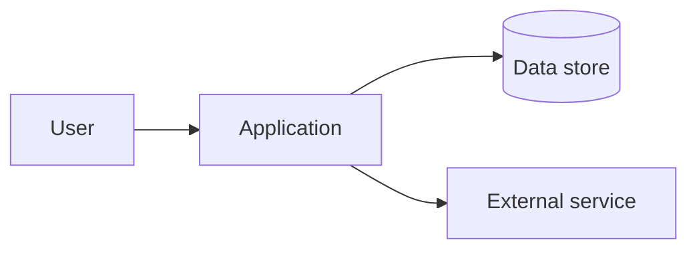

# Architecture Plan — [Product or Milestone]

*Keep this a concise project-wide reference for the confirmed stage and concrete scope. Do not
design speculative scale infrastructure. Clearly label decisions, later approved choices, and
options that still require evaluation or approval.*

**Status:** Proposed  
**Stage:** [Finding Product-Market-Fit (PMF) / Growth / Scale]  
**Scope:** [New product baseline / Architecture impact review]  
**Related product spec:** [path or N/A]  
**Date:** [YYYY-MM-DD]
**Technology stack approval:** [Pending / Approved]

## Purpose and Boundaries

- **Product or change:** [What is being built or changed]
- **Critical journeys:** [The user flows the design must support]
- **In scope:** [Systems and responsibilities covered]
- **Out of scope:** [Explicit exclusions]
- **Constraints:** [Verified technical, operational, regulatory, or budget constraints]

## System Shape

Replace this example with the actual proposed boundaries and flows. Label important data
ownership and trust boundaries; avoid detail that does not affect a decision.

### Components and Responsibilities

| Component | Role and data ownership / default | Does not own | Initial delivery | Later need / trigger | Decision status |
|---|---|---|---|---|---|
| [Component] | [Responsibility; source of truth if applicable] | [Boundary] | [Implement / defer] | [Concrete requirement or condition, not speculative scale] | [Proposed / approved / option] |

### Critical Data Flows

1. [Actor/action → components → data or external services → user-visible outcome]

## Five-Pillar Architecture

| Pillar | Proposed approach for this stage | Main risk addressed | Deferred / revisit trigger |
|---|---|---|---|
| Infrastructure & hosting | | | |
| Code quality & testing | | | |
| Security & data | | | |
| Observability & cost | | | |
| Failure & rollback | | | |

## Risk Profiles and Safeguards

*Assess actual use cases and data flows, not labels alone. Examples include generative AI,
sensitive personal data, healthcare, payments, and consequential decisions. State "None
identified" with a reason when appropriate; record material unknowns rather than guessing legal
or provider requirements. These profiles cut across the five pillars; summarize and reference
details there or in risks and deferred work instead of repeating them.*

| Profile and use case / data | Potential harm and applicable requirements or unknowns | Safeguards needed now, before which use, and verification | Safely deferred safeguards, interim boundary, gate, owner and revisit trigger |
|---|---|---|---|
| [Profile] | [Risk, evidence or unresolved obligation] | [Control, specific activation/release gate, evidence] | [Later control, safe boundary, responsible owner and trigger; or none] |

*For generative AI, include a proportionate evaluation approach and data-provider/privacy
considerations. Do not expose real users or data to an affected use while required safeguards
or material uncertainties remain unresolved.*

## Existing Technology Stack Findings

*Date these findings as a snapshot. Report only what repository evidence verifies. Cite manifests, configuration, deployment files, or engineering docs. Use "None found" or "Unable to verify" instead of guessing.*

**Findings as of:** [YYYY-MM-DD]

| Layer | Found in codebase | Evidence | Impact on recommendation |
|---|---|---|---|
| Frontend framework/runtime | | | |
| Backend framework/runtime | | | |
| Hosting/deployment | | | |
| Database | | | |
| Authentication | | | |
| AI/model integration | | | |
| Observability/analytics | | | |

## Proposed Technology Stack

*Recommendations are not selected until the user approves them. Express budget estimates in USD unless the user names another currency.*

| Layer | Existing choice | Recommended option | Alternative | Why retain/change; fit and tradeoffs | Cost assumption or unknown | User decision |
|---|---|---|---|---|---|
| Frontend framework | | | | | | Pending |
| Backend framework/runtime | | | | | | Pending |
| Hosting/deployment | | | | | | Pending |
| Database | | | | | | Pending |
| Authentication | | | | | | Pending |
| AI/model integration | | | | | | Pending |
| Observability/analytics | | | | | | Pending |

### Approval Questions

- [Ask the user to approve or change the proposed stack and blocking architecture decisions.]

## Consequential Decisions

| Decision | Options and tradeoffs | Recommendation | Confidence / cost to change |
|---|---|---|---|
| [Decision] | [Options] | [Choice and why] | [Confidence and reversibility] |

### ADRs to Record

- [Decision that needs a durable ADR, or "None identified"]

## Risks, Assumptions, and Open Questions

- **Risk:** [Impact, likelihood, and mitigation or acceptance]
- **Assumption:** [Evidence, confidence, and how to validate]
- **Open question:** [Question, recommendation, and whether it blocks planning]
- **Budget:** [Separate any AI spending cap from platform and other operating costs; give estimated recurring/usage-based costs and assumptions in USD by default, including exclusions and unknowns]

## Deliberately Deferred

- [Concrete later need, whether the technology is approved or only an option, and when to revisit]
- [Deferred control, interim safe boundary, and release/usage gate; or none]

## Implementation Status

*A brief dated summary of what has shipped versus what remains planned. Detailed current
behavior belongs in `specs/engineering/`; link it rather than duplicating it.*

- **As of [YYYY-MM-DD]:** [Implemented, deferred, and links to shipped-system specs]

## Architecture Impact Review

*For checkpoint reviews only.*

- **Review date and status:** [YYYY-MM-DD; Proposed / Approved]
- **Change and reason:** [What prompted this review]
- **Affected components, flows, and pillars:** [What changes]
- **New or superseded decisions:** [Decision references]
- **Effective decision after approval:** [Current choice and boundary; retain prior decision in this review or an ADR]
- **Does the baseline remain coherent?** [Yes / No, with explanation]
- **Follow-up before implementation:** [Actions or none]
