# product-engineering

Builds a product spec into working, tested code, one unit at a time. Every unit's contract is planned up front:
- automated tests;
- manual walkthroughs;
- analytics events.

Each unit is then built tests-first, checked by a separate verifier that didn't write the code, and synced back into the living specs. Guardrails act as locks, scaled to each unit's risk, not as instructions the agent could ignore.

The **maker** is the AI agent that writes the tests and builds one unit. A separate
**verifier** checks its work; a **scribe** updates the documentation after verification. The
orchestrator coordinates the process and brings decisions to you.

Instructions for Claude live in [SKILL.md](SKILL.md). This page is for people.

## Flow

```mermaid
flowchart TD
    start([Final product spec]) --> architecture
    architecture[Architecture baseline or<br/>focused impact review when needed] --> setup

    subgraph P0["Phase 0 · Setup, once per repo"]
        setup[CONFIG.md: commands, paths, models] --> guard{{"You run the guardrail generator<br/>and configure approved services"}}
        guard --> check[Guardrail check returns ok]
    end

    check --> frame

    subgraph P1["Phase 1 · Milestone plan & unit contracts"]
        frame[Read architecture: use now,<br/>defer, boundaries and gates] --> seq[Sequence units:<br/>skeleton → P0 → P1 → P2 → reporting]
        seq --> contracts[Write every unit contract up front:<br/>tests, manual steps, events, risk]
        contracts --> scen[Find edge and failure scenarios]
        scen -- unclear behaviour --> ask{{"You clarify"}}
        ask --> scen
        scen --> seams[Check seams and dependencies]
    end

    seams --> approve{{"You approve the plan"}}
    approve --> adr

    adr{Needs an architecture decision?} -- yes --> adrq{{"You choose an option;<br/>an ADR is written"}}
    adr -- no --> risk
    adrq --> risk

    subgraph LOOP["For each unit, in order"]
        risk{High risk?} -- yes --> hr{{"You approve the design and locks"}}
        risk -- no --> tests
        hr --> tests
        tests[Phase 3 · Write tests first,<br/>confirm they fail] --> build[Phase 4 · Build until green, then simplify]
        build --> verify[Phase 5 · Independent verifier]
        verify -- fail --> refix[New maker fixes,<br/>new verifier re-checks]
        refix -- after 3 fails --> stuck{{"You decide"}}
        refix --> verify
        verify -- pass --> scribe[Phase 6 · Sync living specs]
        scribe --> unitdone{{"You run the manual steps"}}
    end

    unitdone --> p0q{Last P0 unit done?}
    p0q -- yes --> p0c{{"P0 checkpoint: you use the P0 journeys,<br/>check the hypothesis-metric events,<br/>run /product-launch-audit before real users"}}
    p0q -- no --> more
    p0c --> more{More units?}
    more -- yes --> risk
    more -- no --> done([Milestone moved to history])

    classDef you fill:#fff4d6,stroke:#c99a2e,color:#3d2e00;
    class guard,ask,approve,adrq,hr,stuck,unitdone,p0c you;
```

Yellow boxes are where the skill stops and waits for you.

## Where it stops for you

| Stop | What you do |
|---|---|
| Phase 0 setup | Run the guardrail generator yourself and configure approved service credentials, or explicitly defer setup with its readiness gates recorded. The agent never handles credentials. |
| Unclear behaviour | Answer a concrete question with options. The agent never guesses product behaviour. |
| Plan checkpoint | Approve the milestone plan, unit contracts and ADRs before any code. |
| Architecture decision | Approve a new or changed material choice; an already-approved choice need not be selected again. Required decisions are recorded as ADRs. |
| High-risk unit | Approve its design and locks before it's built. |
| After each unit | Run the manual walkthrough steps, including any paid live test, whose cost is shown first. |
| P0 checkpoint | Use the P0 journeys hands-on, confirm the hypothesis-metric events arrive, and run `/product-launch-audit` before real users. The skill waits for you to start it. |

## What you get

- `active/NN-<milestone>/`: a plan and one contract per unit. Moved to `history/` when the milestone is done.
- A milestone mapping of the approved architecture: what is used now, deferred, and gated; each unit links the plan and names only its relevant boundaries.
- Tests written before the code at four levels: unit, integration, end-to-end and live.
- `history/decisions/`: an ADR for each architecture and guardrail decision.
- Living specs in `specs/engineering/`, kept in sync with shipped code.
- Analytics events for every journey, plus a reporting unit at the end.

## Works with

- [product-scoping](../product-scoping/README.md) supplies the spec and flows that units are built against.
- [product-architecture](../product-architecture/README.md) establishes the system baseline before a new product is built and checks consequential architecture changes.
- [product-design](../product-design/README.md) supplies the accepted mocks for UI units.
- [product-launch-audit](../product-launch-audit/README.md) runs before real users.
