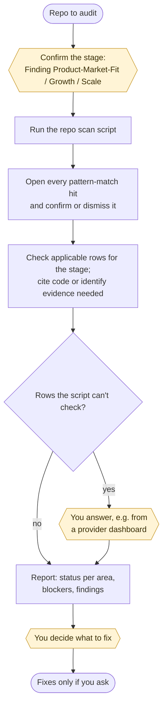

# product-launch-audit

A pre-launch check of an existing app, repeated when material launch risks change. It covers five areas:
- infrastructure;
- code quality;
- security;
- observability and cost;
- failure and rollback.

It works on any codebase, including Replit, Lovable or Bolt prototypes, whether or not it was built with `product-engineering`. It reports only; it fixes nothing unless you ask.

Instructions for Claude live in [SKILL.md](SKILL.md). This page is for people.

## Flow

Yellow boxes are where the skill stops and waits for you.

## Where it stops for you

| Stop | What you do |
|---|---|
| Start | Confirm Finding Product-Market-Fit (PMF), Growth or Scale, unless already confirmed in the architecture plan. [Stage definitions](CHECKLIST.md#product-stages) guide the checklist; actual risks may call for stronger controls earlier. |
| Rows needing a human | Check excluded environment files privately and answer from your accounts or dashboards, e.g. whether a paid API key has a spending cap. Never share secret values. Nothing is marked as passing on a guess. |
| Report | Choose what to fix, if anything. |

## What you get

- A status table covering the five areas: ✅, ⚠️ or 🔴.
- **Blockers**, with file and line for code or evidence needed for manual/infrastructure findings. Any 🔴 in security is a launch blocker and is listed first.
- Evidence and unresolved gates for relevant risk profiles, including whether planned AI
  evaluations have evidence; the audit does not independently evaluate model output quality.
- Findings in three groups:
  - fixes the AI can make;
  - fixes that need a credential or account from you first;
  - things that aren't a code problem, such as a rollback dry run or a spending cap.

The checklist is in [CHECKLIST.md](CHECKLIST.md).

## Works with

- [product-engineering](../product-engineering/README.md) asks you to run this audit before real users; it does not start it automatically.
- [product-architecture](../product-architecture/README.md) supplies the approved intent and release gates; the audit verifies actual readiness rather than assuming the plan is implemented.
